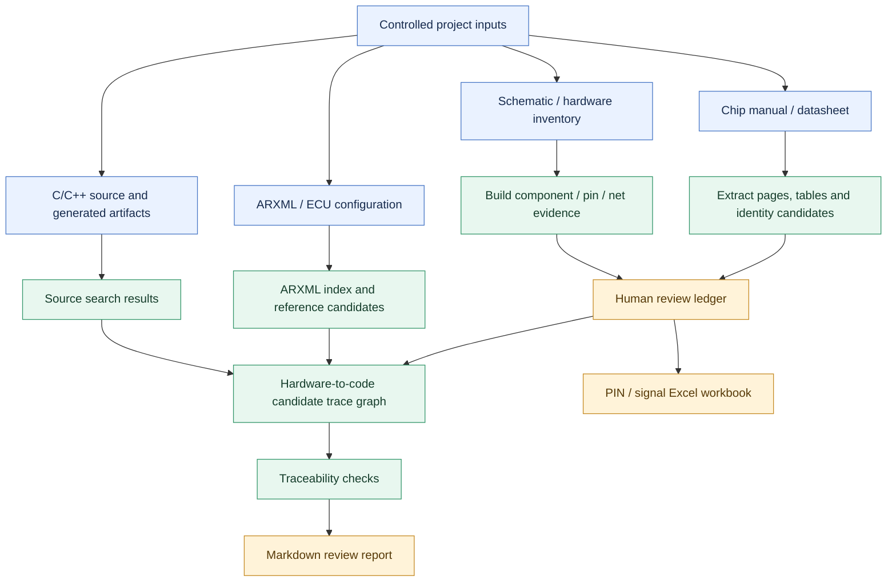
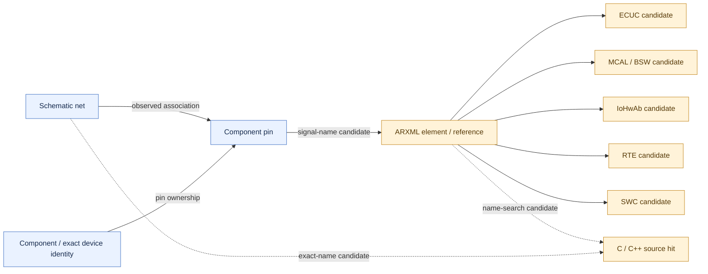

# ELEAgent

<p align="center">
  <strong>Evidence-driven engineering for embedded systems and automotive ECUs</strong><br>
  From chip manuals and schematics to AUTOSAR configuration, source-code candidates, and reviewable traceability reports.
</p>

<p align="center">
  <a href="https://github.com/ilikui/ELEAgent/actions"></a>
  
  
  
</p>

> [!IMPORTANT]
> **Candidate analysis is not engineering approval.** Name matches, extracted tables, identity matches, and generated trace links must be reviewed against controlled project artifacts. ELEAgent does not expose tools to directly modify ECU source code, ARXML, ECUC configuration, or generated code.

## Contents

- [What it does](#what-it-does)
- [Workflow at a glance](#workflow-at-a-glance)
- [Traceability model](#traceability-model)
- [Capabilities](#capabilities)
- [Quick start](#quick-start)
- [MCP tools](#mcp-tools)
- [Agent Skills](#agent-skills)
- [Local CLI workflow](#local-cli-workflow)
- [Evidence and safety rules](#evidence-and-safety-rules)
- [Documentation](#documentation)

## What it does

ELEAgent combines reusable **Agent Skills**, a local **Model Context Protocol (MCP) stdio server**, and Python analysis scripts for embedded and automotive ECU engineering.

It helps engineers move from source evidence to reviewable engineering artifacts:

- Chip manual extraction, page/topic indexing, candidate table extraction and identity checks.
- Schematic component, pin, net and cross-sheet analysis.
- Hardware inventory and human-review ledger with Excel export.
- ARXML element/reference indexing and C/C++ source search.
- Candidate trace graph from schematic net and pin evidence to ECUC, MCAL, IoHwAb, RTE, SWC and source-code search results.
- Traceability gap checks and Markdown review reports.

A `SKILL.md` describes the domain workflow; it is **not** an MCP server. The local `mcp_server.py` exposes callable tools over stdio. Use both to provide the assistant with domain instructions and executable analysis tools.

## Workflow at a glance

The diagram below uses GitHub-supported Mermaid syntax and should render directly on this README.



## Traceability model

ELEAgent builds **candidate links with provenance**, not a claim that the entire ECU behavior has been proven.



| Evidence / status | Meaning |
|---|---|
| Extracted | Parsed from an input artifact; verify extraction fidelity. |
| Candidate | A possible match or relationship; not confirmed. |
| Verified | The cited evidence was reviewed for that record; not an engineering or safety approval. |
| Conflict | Evidence or review results disagree and need resolution. |
| Gap | Required evidence or a trace link is missing, unresolved or ambiguous. |

The graph uses conservative, normalized exact-name matching for candidate discovery. It does not infer aliases, prove electrical connectivity, validate release-specific ECUC semantics, or prove runtime data flow by itself.

## Capabilities

| Area | What you get | Output |
|---|---|---|
| Chip manual analysis | Device identity candidates, pin mux, electrical limits, registers, timing, reset/clock/boot and errata topics | Page-indexed JSON and evidence snippets |
| PDF extraction | Selectable text by page, SHA-256, optional page rendering and low-text-page review flags | Text files and manifest |
| Table extraction | Candidate pin, mux, register, electrical and timing tables with raw cells and page provenance | Reviewable JSON |
| Identity review | Compare label-matched manual candidates against a BOM/device manifest | Candidate checks with evidence and hashes |
| PIN review | Separate review ledger for `candidate`, `verified`, `conflict`, `rejected` | Reviewed inventory JSON |
| Excel export | Component inventory, PIN/signal matrix and cross-sheet net information | Multi-sheet workbook |
| ARXML analysis | Element indexing and heuristic reference discovery | ARXML index JSON |
| Source search | Search C/C++, headers and supported configuration files for supplied terms | Source-hit JSON |
| Hardware-to-code trace | Connect net/pin evidence to ARXML and source-search candidates; flag gaps | Candidate trace graph JSON |
| Review reporting | Check graph links and summarize missing evidence / unresolved relationships | Markdown report |

## Quick start

### Requirements

- Python 3.10 or newer.
- VS Code with GitHub Copilot Chat in Agent mode, if using the MCP workflow.
- Local copies of the project artifacts you are authorized to analyze.
- The repository's Python dependencies.

### Install

```bash
git clone https://github.com/ilikui/ELEAgent.git
cd ELEAgent
python -m pip install -r requirements.txt
```

### Configure MCP in VS Code

This repository includes `.vscode/mcp.json` for a local stdio server.

1. Open the ELEAgent repository in VS Code.
2. Review `.vscode/mcp.json` and the configured workspace path before enabling the server.
3. Install dependencies using the command above.
4. Open Copilot Chat in **Agent** mode and approve the workspace MCP server when prompted.
5. Run **MCP: List Servers** and check that `eleagent` starts.
6. Ask the assistant to call `get_workspace_info`, then try `analyze_chip_manual` on a local chip manual.

If startup fails, check that Python is on `PATH` and inspect the MCP server output.

### Workspace boundary

Tool paths are relative to `ELEAGENT_WORKSPACE` and must remain inside that workspace. For best results, set the workspace to the ECU project directory and make sure the configured MCP server script path points to this repository. Keep customer paths, proprietary configuration and restricted documents out of public commits.

See the [MCP setup and security guide](docs/mcp-setup.md).

## MCP tools

| Tool | Purpose | Writes |
|---|---|---|
| `get_workspace_info` | Report configured workspace and available tools | No |
| `extract_pdf` | Extract selectable per-page text and optionally render pages | Extraction output only |
| `analyze_chip_manual` | Build a topic/page index with document hash, snippets and review gaps | JSON report only |
| `extract_chip_manual_tables` | Extract candidate tables with raw cells, page and topic hints | JSON report only |
| `normalize_chip_manual_tables` | Normalize recognized headers while retaining raw rows and provenance | JSON report only |
| `review_chip_identity` | Compare manual identity candidates with an optional BOM/device manifest | JSON report only |
| `merge_chip_identity_review` | Attach identity review evidence to components without overwriting source fields | JSON output only |
| `review_pin_inventory` | Apply review ledger to component-reference / pin-number pairs | JSON output only |
| `build_hardware_code_trace` | Link schematic nets/pins to ARXML/source candidates and emit gaps | JSON output only |
| `analyze_arxml` | Index ARXML elements and candidate references | JSON report only |
| `scan_source` | Search C/C++ and supported configuration files | JSON report only |
| `check_traceability` | Validate supported traceability data and flag gaps | No |
| `build_review_report` | Generate an evidence review report | Markdown report only |
| `export_pin_excel` | Export PIN/signal inventory to a multi-sheet workbook | Excel workbook only |

All tool input/output paths are constrained to `ELEAGENT_WORKSPACE`; absolute paths and path traversal are rejected. No MCP tool is exposed for editing source code, ARXML, ECUC configuration or generated code.

## Agent Skills

| Skill | Use it for |
|---|---|
| [chip-datasheet-analysis](.github/skills/chip-datasheet-analysis/SKILL.md) | Evidence-backed analysis of chip manuals, identity, pin mux, electrical limits, registers, timing and errata |
| [circuit-schematic-analysis](.github/skills/circuit-schematic-analysis/SKILL.md) | Components, pins, nets, cross-sheet connections and automotive ECU circuit review |
| [autosar-hw-code-traceability](.github/skills/autosar-hw-code-traceability/SKILL.md) | Hardware-to-code candidate tracing, evidence review and traceability gaps |
| [pdf-book-to-skill](.github/skills/pdf-book-to-skill/SKILL.md) | Turn technical PDFs into private, cited knowledge |

### Example prompts

- **MCU manual:** “Use `/chip-datasheet-analysis` on this exact MCU manual. Identify ordering code, package and revision; index pin mux, electrical limits, registers, timing and errata with PDF page citations. Flag ambiguous tables for visual review.”
- **Schematic and PIN matrix:** “Use `/circuit-schematic-analysis` to inspect the schematic and inventory component pins, net labels and cross-sheet references. Preserve page/sheet evidence and flag unresolved connections.”
- **Hardware to AUTOSAR:** “Use `/autosar-hw-code-traceability` to trace evidenced signals through ARXML and C/C++ source. Separate confirmed source facts from name-match candidates and list missing links.”
- **Technical PDF knowledge:** “Use `/pdf-book-to-skill` to outline this local PDF, preserve page citations and keep generated knowledge private.”

## Local CLI workflow

Install dependencies first:

```bash
python -m pip install -r requirements.txt
```

### 1. Extract and index a chip manual

```bash
python .github/skills/autosar-hw-code-traceability/scripts/extract_pdf.py \
  path/to/chip_manual.pdf --out engineering/extracted/pdf_text --render

python .github/skills/autosar-hw-code-traceability/scripts/analyze_chip_manual.py \
  path/to/chip_manual.pdf --out engineering/chip_manual/chip_manual_analysis.json

python .github/skills/autosar-hw-code-traceability/scripts/extract_chip_tables.py \
  path/to/chip_manual.pdf --out engineering/chip_manual/chip_manual_tables.json

python .github/skills/autosar-hw-code-traceability/scripts/normalize_chip_tables.py \
  engineering/chip_manual/chip_manual_tables.json \
  --out engineering/chip_manual/chip_manual_review_records.json
```

### 2. Review device identity and PIN data

```bash
python .github/skills/autosar-hw-code-traceability/scripts/review_chip_identity.py \
  engineering/chip_manual/chip_manual_analysis.json \
  --out engineering/chip_manual/chip_identity_review.json

python .github/skills/autosar-hw-code-traceability/scripts/merge_chip_identity.py \
  engineering/hardware/hardware_inventory.json \
  engineering/chip_manual/chip_identity_review.json \
  --out engineering/hardware/hardware_inventory_with_identity.json

python .github/skills/autosar-hw-code-traceability/scripts/review_pin_inventory.py \
  engineering/hardware/hardware_inventory_with_identity.json \
  engineering/hardware/pin_review_ledger.json \
  --out engineering/hardware/hardware_inventory_reviewed.json

python .github/skills/autosar-hw-code-traceability/scripts/export_pin_excel.py \
  engineering/hardware/hardware_inventory_reviewed.json \
  --out engineering/reports/pin_signal_inventory.xlsx
```

For the ledger format, see [the example PIN review ledger](examples/pin_review_ledger.example.json). Replace example values and paths with controlled project data. If you have a BOM/device manifest, pass `--manifest path/to/your_device_manifest.json` to the identity review script.

### 3. Build hardware-to-code candidate traceability

```bash
python .github/skills/autosar-hw-code-traceability/scripts/analyze_arxml.py \
  path/to/arxml --out engineering/traceability/arxml_analysis.json

python .github/skills/autosar-hw-code-traceability/scripts/scan_source.py . \
  --terms "CONFIRMED_NET,Dio_WriteChannel,Rte_Read" \
  --out engineering/traceability/source_hits.json

python .github/skills/autosar-hw-code-traceability/scripts/build_hardware_code_trace.py \
  engineering/hardware/hardware_inventory_reviewed.json \
  --arxml-index engineering/traceability/arxml_analysis.json \
  --source-hits engineering/traceability/source_hits.json \
  --out engineering/traceability/hardware_code_trace.json

python .github/skills/autosar-hw-code-traceability/scripts/check_traceability.py \
  engineering/traceability/hardware_code_trace.json

python .github/skills/autosar-hw-code-traceability/scripts/build_review_report.py \
  engineering/traceability/hardware_code_trace.json \
  --out engineering/reports/hardware_code_trace_review.md
```

The example names such as `CONFIRMED_NET` are search terms, not pre-verified project signals. Check each script's `--help` if your local version uses different arguments, and review every candidate edge against the source artifacts.

### 4. Run tests

```bash
python -m unittest discover -s tests -v
```

## Evidence and safety rules

- **Cite the source:** preserve document name/revision, PDF page, schematic sheet/page, ARXML path/reference, source path/line and verification-log reference where available.
- **Do not guess:** never invent pin numbers, polarity, register values, electrical limits, requirements, tool outcomes or build results.
- **Keep candidates separate:** exact-name matches and normalized table fields remain candidates until reviewed.
- **Resolve identity first:** confirm exact ordering code, package and relevant silicon/document revision before relying on pinout or electrical data.
- **Respect generated-code ownership:** use the project's authoritative configuration and generator workflow; do not hand-edit generated code based on a candidate trace.
- **Keep safety decisions independent:** a reviewed record or passing static check does not establish electrical correctness, ASIL compliance or functional-safety approval.
- **Protect confidential data:** do not publicly commit customer PDFs, restricted chip manuals, proprietary source or confidential book-derived knowledge without authorization.

## Documentation

- [MCP setup and security](docs/mcp-setup.md)
- [Chip datasheet analysis Skill](.github/skills/chip-datasheet-analysis/SKILL.md)
- [Circuit schematic analysis Skill](.github/skills/circuit-schematic-analysis/SKILL.md)
- [AUTOSAR hardware-to-code traceability Skill](.github/skills/autosar-hw-code-traceability/SKILL.md)
- [PDF book-to-Skill workflow](.github/skills/pdf-book-to-skill/SKILL.md)
